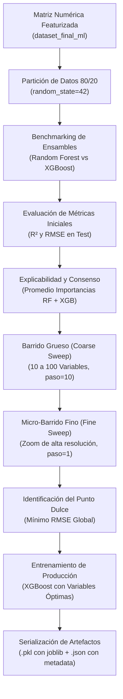

---

# Plataforma Predictiva de Ciencia de Materiales: Módulo de Young y Límite Elástico en MPEAs

Este proyecto forma parte de un portafolio académico enfocado en la Ingeniería de Materiales. Su objetivo principal es predecir propiedades mecánicas clave (Módulo de Young y Límite Elástico) de aleaciones de alta entropía y composición múltiple (MPEAs) a partir de su fórmula estequiométrica y condiciones de procesamiento, mitigando la necesidad de pruebas físicas destructivas.

El conjunto de datos base (`MPEA_dataset.csv`) fue proporcionado como material de estudio académico para la cátedra. 

### Justificación del Modelado y Limitaciones
Dado el volumen relativamente pequeño de datos experimentales disponibles, se descartó el uso de redes neuronales profundas (Deep Learning) para evitar el sobreajuste. En su lugar, se optó por comparar modelos de ensamble basados en árboles (Random Forest y XGBoost). 

Para compensar la escasez de datos, se aplicó una estrategia de **aumento de características** (*feature engineering*) utilizando la librería `matminer`, la cual extrae cientos de descriptores fisicoquímicos automáticamente a partir de la fórmula química. Posteriormente, se realizó una estricta reducción de dimensionalidad basándose en la importancia de características para encontrar el subconjunto de variables con el mínimo error.

**Advertencia de Extrapolación:** Este modelo debe usarse con fines estadísticos e interpolativos. Dado que el aprendizaje está atado a la distribución de los datos de entrenamiento, **no se pueden extrapolar** predicciones precisas para composiciones, aleaciones o regímenes térmicos que se alejen drásticamente del espacio de datos original.

---

## Inicio Rápido (TL;DR)

Hay una app para una ejecución rápida en streamlit:
https://predictordelimiteelasticoymodulodeyoung-xxtmt8n2hfaxb2em5qlaat.streamlit.app/

Si deseas interactuar con la plataforma y realizar inferencias rápidas sin necesidad de reentrenar los modelos, sigue estos sencillos pasos:

**1. Instalar dependencias:** 
Las versiones exactas recomendadas para asegurar la compatibilidad (especialmente con `matminer` y `pymatgen`) se encuentran en el archivo de requerimientos.
```bash
pip install -r requirements.txt


```

**2. Ejecutar la plataforma:**
Corre el orquestador principal. Este script levantará el servidor Flask de inferencia y abrirá automáticamente una pestaña en tu navegador web.

```bash
python main.py

```

**3. Realizar predicciones:**
En la interfaz web encontrarás opciones y **presets ya incluidos** (ejemplos de prueba preconfigurados) para que puedas evaluar el funcionamiento del modelo inmediatamente.


*Figura 1: Interfaz principal con tema oscuro y presets de aleaciones cargados.*


*Figura 2: Resultados de inferencia en tiempo real para Módulo de Young y Límite Elástico.*


**Nota para replicación:** Si deseas inspeccionar, modificar o reentrenar los modelos abriendo los archivos `.ipynb` (Fase 3), se recomienda **ejecutarlos en Google Colab** para aprovechar la aceleración en la nube y agilizar el proceso.

---

## 1. Estructura del Repositorio

El repositorio está organizado de forma modular, separando las fases de curación de datos, featurización, experimentación en cuadernos, serialización de modelos y frontend de inferencia:

```text
Joung y Limite elastico/
├── MPEA_dataset - MPEA_dataset.csv   # Base de datos experimental original de aleaciones MPEAs (1,545 filas x 23 columnas)
├── main.py                           # Orquestador principal: inicia el servidor web y abre la interfaz de inferencia
├── README.md                         # Documentación técnica maestra y bitácora unificada del proyecto
├── requirements.txt                  # Dependencias del entorno de ejecución (matminer, xgboost, scikit-learn, flask, etc.)
├── LICENSE                           # Licencia de código abierto MIT
│
├── Manejo de los datos/              # FASE 1: Exploración, análisis combinatorio y curación
│   ├── MPEA_dataset.csv              # Copia local del dataset base de MPEAs
│   ├── analisis_headers.py           # Diagnóstico de columnas y conteo de valores no nulos
│   ├── exploracion_combinaciones.py  # Algoritmo de optimización combinatoria Branch & Bound (poda monótona)
│   ├── generar_dataset_filtrado.py   # Filtrado, depuración de metadatos y exportación técnica
│   ├── main_manejo_datos.py          # Script orquestador de la fase de manejo de datos
│   └── resumen_optimizacion_headers.csv # Reporte tabular con los subconjuntos óptimos para cada k
│
├── Modulo_de_young/                  # FASE 2A: Pipeline del Módulo de Young (E)
│   ├── dataset.csv                   # Dataset curado con las 13 columnas óptimas (550 filas x 13 columnas)
│   ├── dataset_final_ml_2.csv        # Matriz numérica featurizada para ML (550 filas x 271 columnas)
│   ├── main_modulo_de_young.py       # Pipeline de extracción, featurización con matminer y One-Hot Encoding
│   └── model.ipynb                   # Cuaderno de modelado, explicabilidad y reducción dimensional a 27 variables
│
├── Limite_elastico/                  # FASE 2B: Pipeline de Límite Elástico (YS)
│   ├── dataset.csv                   # Dataset curado con 8 columnas técnicas (1,008 filas x 8 columnas)
│   ├── dataset_final_ml.csv          # Matriz numérica featurizada para ML (1,008 filas x 306 columnas)
│   ├── main_limite_elastico.py       # Pipeline de extracción, featurización con matminer y One-Hot Encoding
│   └── model.ipynb                   # Cuaderno de modelado, explicabilidad y reducción dimensional a 51 variables
│
├── Models/                           # FASE 3: Modelos entrenados y metadatos de producción
│   ├── xgboost_Calculated Young modulus (GPa).pkl   # Modelo final serializado para Módulo de Young (27 vars)
│   ├── variables_Calculated Young modulus (GPa).json # Metadata y descriptores de entrada requeridos
│   ├── xgboost_Limite_Elastico_YS_MPa.pkl           # Modelo final serializado para Límite Elástico (51 vars)
│   └── variables_Limite_Elastico_YS_MPa.json       # Metadata y descriptores de entrada requeridos
│
└── Front/                            # FASE 4: Aplicación Web para Inferencia en Tiempo Real
    ├── app.py                        # Servidor backend Flask y API REST de cálculo de descriptores e inferencia
    ├── templates/
    │   └── index.html                # Interfaz de usuario con diseño de dos pestañas e iconos SVG
    └── static/
        ├── css/
        │   └── style.css             # Sistema de diseño Obsidian Dark, glassmorphism y tipografía Inter
        └── js/
            └── app.js                # Lógica reactiva frontend, validaciones y consumo asíncrono de la API

```

---

## 2. Fase 1: Exploración y Manejo de Datos

El objetivo central de la primera etapa consistió en inspeccionar la completitud del archivo base `MPEA_dataset.csv` (1,545 filas x 23 columnas) y determinar qué combinaciones de encabezados (*headers*) maximizan el volumen de información simultánea utilizable, mitigando la pérdida masiva de datos provocada por valores faltantes (`NaN`).

### 2.1 Metodología de Procesamiento

1. **Carga y Diagnóstico Individual (`analisis_headers.py`)**:
* Lectura del archivo CSV mediante `pandas`.
* Extracción de la lista completa de las 23 columnas que componen el dataset.
* Diagnóstico individual de la proporción de valores no nulos por columna.


2. **Función de Intersección Simultánea (`contar_filas_no_nulas`)**:
* Se diseñó una función que toma por entrada un subconjunto arbitrario de headers $S$ y calcula el número exacto de filas que presentan datos válidos al mismo tiempo en todas esas columnas:

$$\text{Filas Válidas}(S) = \sum_{i=1}^{N} \prod_{c \in S} \mathbb{I}(\text{valor}_{i,c} \neq \text{NaN})$$


* Permite evaluar de manera determinista cualquier hipótesis de selección de variables.


3. **Optimización Combinatoria (`exploracion_combinaciones.py`)**:
* Espacio total de búsqueda: $2^{23} = 8,388,608$ combinaciones posibles.
* Algoritmo implementado: Búsqueda exhaustiva mediante poda de árbol (*Branch and Bound* monótono) con representación binaria de bits (*bitmasks*). Dado que la intersección de no nulos es monótonamente decreciente, cualquier rama con 0 filas se poda inmediatamente.
* Rendimiento: Evaluación de más de 2.7 millones de subconjuntos válidos en aproximadamente 1 segundo.


### 2.2 Resultados de la Optimización Combinatoria

La exploración sistemática permitió identificar el mejor subconjunto de variables para cada número de columnas ($k$):

| $k$ (Headers) | Filas No Nulas | % del Dataset | Puntos de Información ($k \times \text{Filas}$) | Columnas Seleccionadas en el Subconjunto Óptimo |
| --- | --- | --- | --- | --- |
| **1 a 6** | 1,545 | 100.0% | Hasta 9,270 | `ID`, `FORMULA`, `BCC/FCC/other`, `Calculated Density (g/cm^3)`, `REFERENCE: doi`, `REFERENCE: year` |
| **7** | 1,535 | 99.4% | 10,745 | Agrega `REFERENCE: title` |
| **8** | 1,416 | 91.7% | 11,328 | Agrega `Processing method` |
| **9** | 1,347 | 87.2% | 12,123 | Agrega `Microstructure` |
| **10** | **1,258** | **81.4%** | **12,580** (Máximo global) | Agrega `Test temperature ($^\circ$C)` |
| **11** | 1,082 | 70.0% | 11,902 | Agrega `Type of test` |
| **12** | 1,001 | 64.8% | 12,012 | Agrega `YS (MPa)` |
| **13** | 550 | 35.6% | 7,150 | Agrega `Calculated Young modulus (GPa)` |
| **14** | 305 | 19.7% | 4,270 | Agrega `Elongation (%)`, `UTS (MPa)` |
| **15** | 172 | 11.1% | 2,580 | Agrega `Calculated Young modulus (GPa)` |
| **16** | 86 | 5.6% | 1,376 | Agrega `grain size ($\mu$m)` |
| **17** | 28 | 1.8% | 476 | Agrega `Exp. Young modulus (GPa)` |
| **18** | 5 | 0.3% | 90 | Agrega `HV` |
| **$\ge$ 19** | 0 | 0.0% | 0 | No existen registros completos con 19 o más columnas simultáneas |

### 2.3 Curación y Filtrado Técnico (`generar_dataset_filtrado.py`)

A partir del análisis combinatorio, se determinó eliminar las variables de metadatos o referencias bibliográficas (`ID`, `REFERENCE: doi`, `REFERENCE: year`, `REFERENCE: title`) debido a que carecen de valor físico o termodinámico.

Para el modelado de propiedades mecánicas se derivaron dos subconjuntos especializados:

1. **Límite Elástico ($YS$)**: Se seleccionó el nivel $k=12$ (filtrado a 8 variables técnicas sin referencias), preservando **1,008 registros limpios** (65.24% del dataset original). Nombres estandarizados: `Formula`, `Densidad_Calculada_g_cm3`, `Estructura_Cristalina`, `Metodo_Procesamiento`, `Microestructura`, `Temperatura_Prueba_C`, `Tipo_Ensayo`, `Limite_Elastico_YS_MPa`.
2. **Módulo de Young ($E$)**: Se seleccionó el nivel $k=13$, preservando **550 registros limpios** (35.60% del dataset original) con mediciones simultáneas de rigidez elástica calculada (`Calculated Young modulus (GPa)`).

---

## 3. Fase 2: Pipelines de Preprocesamiento y Featurización con Matminer

Para transformar la estequiometría química en descriptores matemáticos aptos para algoritmos de regresión supervisada, se crearon pipelines unificados y automatizados en Python para cada propiedad.

### 3.1 Pipeline de Módulo de Young (`Modulo_de_young/main_modulo_de_young.py`)

1. **Extracción y Limpieza**:
* Lectura del dataset original `MPEA_dataset.csv`.
* Extracción de las 13 columnas del subconjunto óptimo.
* Aplicación de `.dropna()` para asegurar cero valores nulos: **550 filas retenidas**.
* Archivo generado: `Modulo_de_young/dataset.csv`.


2. **Featurización Composicional con Matminer**:
* `StrToComposition`: Conversión de la columna `FORMULA` en objetos `Composition` de `pymatgen`.
* `MultipleFeaturizer` aplicando cuatro familias exactas de descriptores:
* **`ElementProperty.from_preset("magpie")`**: Estadísticas ponderadas (media, desviación estándar, mínimo, máximo, rango y moda) de propiedades elementales basadas en Magpie (electronegatividad, radio atómico, volumen molar, punto de fusión, capas de electrones, etc.).
* **`YangSolidSolution()`**: Parámetros característicos de soluciones sólidas para aleaciones de alta entropía (desajuste de radios atómicos $\delta$, parámetro termodinámico $\Omega$, entalpía de mezcla $\Delta H_{mix}$ y entropía de mezcla $\Delta S_{mix}$).
* **`ValenceOrbital(props=['frac'])`**: Fracción de electrones de valencia distribuidos en capas orbitales s, p, d y f.
* **`ElementFraction()`**: Vector de proporciones molares estequiométricas elementales.


* Eliminación del objeto temporal `composition`.


3. **Codificación Categórica y Depuración**:
* One-Hot Encoding binario estricto (`pd.get_dummies(..., dtype=int)`) sobre las 4 variables categóricas:
* `BCC/FCC/other`
* `Processing method`
* `Microstructure`
* `Type of test`


* Eliminación de columnas de metadatos/documentación no numéricas (`ID`, `REFERENCE: doi`, `REFERENCE: year`, `REFERENCE: title`) y de la columna de texto original `FORMULA`.
* **Resultado final**: Archivo `Modulo_de_young/dataset_final_ml_2.csv` con **550 filas x 271 columnas numéricas** (110 columnas enteras binarias 0/1 y 161 continuas float64; 0 valores nulos, 0 cadenas de texto y 0 booleanos).


### 3.2 Pipeline de Límite Elástico (`Limite_elastico/main_limite_elastico.py`)

1. **Extracción y Limpieza**:
* Lectura de `Limite_elastico/dataset.csv` con las 8 variables técnicas estandarizadas.
* Aplicación de `.dropna()`: **1,008 filas retenidas** (0 valores nulos).


2. **Featurización Composicional con Matminer**:
* Mismo esquema estandarizado de `StrToComposition` y `MultipleFeaturizer` con las 4 familias de descriptores (Magpie, YangSolidSolution, ValenceOrbital y ElementFraction).
* Eliminación de la columna intermedia `composition`.


3. **Codificación Categórica y Depuración**:
* One-Hot Encoding binario (`dtype=int`) sobre las 4 variables categóricas:
* `Estructura_Cristalina`
* `Metodo_Procesamiento`
* `Microestructura`
* `Tipo_Ensayo`


* Eliminación de la columna de texto `Formula`.
* **Resultado final**: Archivo `Limite_elastico/dataset_final_ml.csv` con **1,008 filas x 306 columnas numéricas** (140 columnas enteras binarias 0/1 y 166 continuas float64; 0 valores nulos, 0 cadenas de texto y 0 booleanos).


---

## 4. Fase 3: Procedimiento Técnico de Modelado en los Cuadernos (`model.ipynb`)

El modelado predictivo, análisis de explicabilidad y reducción de dimensionalidad se llevó a cabo en los cuadernos interactivos `Modulo_de_young/model.ipynb` y `Limite_elastico/model.ipynb`. Ambos siguen un protocolo experimental estandarizado y reproducible diseñado para su ejecución en entornos locales.



### Paso 1: Configuración del Entorno y Carga Local

* Configuración de importaciones científicas (`pandas`, `numpy`, `scikit-learn`, `xgboost`, `matplotlib`, `seaborn`).
* Detección automática y robusta de rutas locales para cargar la matriz sin depender de montajes de Google Drive:
* En Módulo de Young: `dataset_final_ml_2.csv` (550 filas x 271 columnas).
* En Límite Elástico: `dataset_final_ml.csv` (1,008 filas x 306 columnas).


### Paso 2: Partición de Datos (Train/Test Split)

* Se separa la variable objetivo ($y$) de la matriz de descriptores predictivos ($X$).
* División estratificada por muestreo aleatorio en 80% entrenamiento y 20% prueba:
```python
X_train, X_test, y_train, y_test = train_test_split(X, y, test_size=0.2, random_state=42)

```


* Fijación estricta de la semilla aleatoria (`random_state=42`) para garantizar reproducibilidad exacta y prevenir la fuga de datos (*data leakage*).

### Paso 3: Benchmarking de Modelos de Ensamble

Se instancian y entrenan dos familias complementarias de modelos basados en árboles de decisión utilizando computación paralela en todos los núcleos del CPU (`n_jobs=-1`):

1. **Random Forest Regressor** (`n_estimators=100`, `random_state=42`): Algoritmo de agregación y remuestreo (*Bagging*) que promedia múltiples árboles descorrelacionados, reduciendo la varianza del modelo.
2. **XGBoost Regressor** (`n_estimators=100`, `learning_rate=0.1`, `random_state=42`): Algoritmo de potenciación de gradiente (*Gradient Boosting*) que construye árboles de forma secuencial corrigiendo los residuos del árbol previo mediante funciones de coste regularizadas ($L_1$/$L_2$).

### Paso 4: Evaluación de Métricas de Generalización

Se evalúan las predicciones sobre el conjunto de prueba inédito (20%) mediante dos métricas cuantitativas:

* **Coeficiente de Determinación ($R^2$)**:

$$R^2 = 1 - \frac{\sum_{i=1}^{n} (y_i - \hat{y}_i)^2}{\sum_{i=1}^{n} (y_i - \bar{y})^2}$$


* **Raíz del Error Cuadrático Medio ($RMSE$)**:

$$RMSE = \sqrt{\frac{1}{n} \sum_{i=1}^{n} (y_i - \hat{y}_i)^2}$$


### Paso 5: Explicabilidad y Consenso de Importancia de Variables (Feature Importance)

Para mitigar el sesgo propio de cada algoritmo (importancia por impureza de Gini en Random Forest vs. ganancia y frecuencia de división en XGBoost):

1. Se extrae el vector `feature_importances_` normalizado de ambos modelos.
2. Se calcula la **importancia promedio de consenso**:

$$\text{Importancia Promedio} = \frac{\text{Importancia}_{\text{RF}} + \text{Importancia}_{\text{XGB}}}{2}$$


3. Se seleccionan y visualizan mediante gráficos comparativos de barras (Seaborn) los 15 descriptores físicos más influyentes.

### Paso 6: Reducción Dimensional - Barrido Grueso (Coarse Sweep)

Entrenar modelos con cientos de variables en datasets de materiales pequeños o medianos aumenta el riesgo de sobreajuste y la latencia computacional.

* Se ordenan los descriptores de mayor a menor importancia según XGBoost.
* Se ejecuta un barrido descendente evaluando el $RMSE$ reteniendo subconjuntos de las $N$ mejores variables (desde 10 hasta 100, en pasos de 10).
* Permite mapear la curva de rendimiento y ubicar visualmente la región del valle de error óptimo.

### Paso 7: Micro-Barrido Fino y Descubrimiento del Punto Dulce (Sweet Spot)

Una vez delimitada la región óptima, se realiza un escaneo granular variable a variable (paso = 1):

* **Módulo de Young**: Escaneo fino de **15 a 39 variables**.
* **Punto Dulce absoluto**: **27 variables**.
* **Métricas finales**: $R^2 = 0.9969$, $RMSE = 2.53$ GPa (reducción del 90% de variables de entrada sin pérdida de precisión).


* **Límite Elástico**: Escaneo fino de **50 a 71 variables**.
* **Punto Dulce absoluto**: **51 variables**.
* **Métricas finales**: $R^2 = 0.7693$, $RMSE = 268.45$ MPa (reducción del 83% de variables de entrada, optimizando el compromiso sesgo-varianza).


### Paso 8: Entrenamiento de Producción y Serialización

Se entrena el estimador final `XGBRegressor` empleando exclusivamente el subconjunto óptimo de variables.

1. Se serializa el modelo entrenado en formato binario mediante `joblib`:
* `Models/xgboost_Calculated Young modulus (GPa).pkl`
* `Models/xgboost_Limite_Elastico_YS_MPa.pkl`


2. Se genera y exporta el archivo de metadatos estandarizado en formato JSON:
* `Models/variables_Calculated Young modulus (GPa).json`
* `Models/variables_Limite_Elastico_YS_MPa.json`
* Incluye el nombre de la propiedad objetivo, métricas oficiales ($R^2$, $RMSE$), cantidad de variables y el listado ordenado de los nombres exactos de los descriptores de entrada necesarios para la inferencia.


---

## 5. Modelos Serializados y Descriptores de Entrada (`Models/`)

La carpeta `Models/` almacena los artefactos listos para su puesta en producción e integración con la API web:

| Modelo | Propiedad Objetivo | Algoritmo | Variables Retenidas | $R^2$ (Test) | $RMSE$ (Test) | Archivo Serializado | Archivo de Metadata |
| --- | --- | --- | --- | --- | --- | --- | --- |
| **Módulo de Young** | `Calculated Young modulus (GPa)` | XGBoost | 27 | **0.9969** | **2.53 GPa** | `xgboost_Calculated Young modulus (GPa).pkl` | `variables_Calculated Young modulus (GPa).json` |
| **Límite Elástico** | `Limite_Elastico_YS_MPa` | XGBoost | 51 | **0.7693** | **268.45 MPa** | `xgboost_Limite_Elastico_YS_MPa.pkl` | `variables_Limite_Elastico_YS_MPa.json` |

### Estructura de los Metadatos JSON (`variables_*.json`)

Los archivos de configuración JSON contienen la información necesaria para que cualquier cliente o servidor reconstruya el vector de inferencia:

```json
{
    "variable_objetivo": "Calculated Young modulus (GPa)",
    "rendimiento": {
        "R2": 0.9969,
        "RMSE": 2.53
    },
    "cantidad_variables": 27,
    "variables_entrada": [
        "MagpieData mean Electronegativity",
        "MagpieData mean NUnfilled",
        "MagpieData mean NpValence",
        "MagpieData mean NdValence",
        "Calculated Density (g/cm$^3$)",
        "..."
    ]
}

```

---

## 6. Fase 4: Plataforma Web de Inferencia en Tiempo Real (`Front/` y `main.py`)

Se desarrolló una aplicación web interactiva que permite a ingenieros y científicos de materiales ingresar la fórmula estequiométrica de una aleación y sus condiciones de procesamiento para obtener al instante las predicciones mecánicas.

### 6.1 Arquitectura del Servidor Backend (`Front/app.py`)

* **Framework**: Flask (Python).
* **Featurización en Vuelo**: Al recibir una fórmula química (ej. `Al0.5CoCrFeNi`), el backend invoca a `matminer` y `pymatgen` en tiempo real para extraer los descriptores composicionales de Magpie y orbitales de valencia requeridos por los modelos.
* **Tratamiento de Residuos y Offsets**: Los modelos XGBoost fueron calibrados sobre los residuos respecto a la media histórica de entrenamiento ($y - \bar{y}$). Para restituir el valor físico absoluto, el servidor suma automáticamente la media del conjunto de datos:
* **Offset Módulo de Young**: $+166.04$ GPa
* **Offset Límite Elástico**: $+879.38$ MPa


### 6.2 Desglose de Entradas por Pestaña

#### Pestaña 1: Módulo de Young ($E$)

* **Total de descriptores requeridos**: 27.
* **Calculados automáticamente por `matminer` (26 variables)**:
* Electronegatividad media, punto de fusión máximo, volumen atómico, peso atómico, número atómico de Magpie.
* Fracción de electrones de valencia en orbitales s, p, d.
* Fracciones molares de aleantes refractarios ($Cr$, $Mo$).


* **Parámetro manual provisto por el usuario (1 variable)**:
* `Calculated Density (g/cm^3)`: Densidad teórica calculada de la aleación.


#### Pestaña 2: Límite Elástico ($YS$)

* **Total de descriptores requeridos**: 51.
* **Calculados automáticamente por `matminer` (42 variables)**:
* Propiedades estadísticas de Magpie (volumen atómico, radio covalente, electronegatividad, peso atómico, punto de fusión, número de grupos espaciales, etc.).
* Parámetro de desajuste atómico de soluciones sólidas de Yang ($\delta$).
* Fracción de orbitales s de valencia.
* Fracciones molares estequiométricas ($Al$, $Ni$, $Mo$, $Mn$, $Fe$, $V$).


* **Parámetros manuales provistos por el usuario (9 variables / selectores)**:
* `Temperatura_Prueba_C`: Temperatura a la que se efectúa el ensayo mecánico (°C).
* `Tipo_Ensayo`: Selector entre Tracción (`T`) o Compresión (`C`).
* `Metodo_Procesamiento`: Selector entre Fundición (`CAST`), Deformación/Forja (`WROUGHT`), Pulvimetalurgia (`POWDER`) u Otro.
* `Estructura_Cristalina`: Selector entre `FCC`, `BCC` u Otra.
* `Microestructura`: Selector entre `FCC simple`, `BCC simple`, `BCC+FCC`, `FCC+BCC`, `BCC+HCP`, `FCC+B2+Sec.` u Otra.


### 6.3 Diseño de la Interfaz de Usuario

* **Tema Obsidian Dark**: Paleta cromática oscura de alta legibilidad técnica (`#090d16`, `#0f172a`, `#1e293b`), bordes sutiles y tarjetas con efecto *glassmorphism*.
* **Iconografía SVG nativa**: Sin uso de emojis ni elementos informales, manteniendo una estética sobria orientada a entornos de investigación y laboratorio.
* **Tipografía moderna**: Integración de la fuente tipográfica *Inter* (Google Fonts).
* **Retroalimentación reactiva**: Validaciones instantáneas en JavaScript (`app.js`), indicador de carga (*spinner*) y visualización de resultados con tarjetas de métricas ($R^2$, $RMSE$).

---

## 7. Guía de Ejecución y Reproducibilidad Complementaria

Si bien el Inicio Rápido provee los comandos esenciales para levantar la web, esta sección detalla cómo replicar individualmente las fases metodológicas.

### 7.1 Reproducción de la Fase 1 (Exploración y Manejo de Datos)

Para re-ejecutar el análisis de combinaciones y diagnósticos de nulos:

```bash
python "Manejo de los datos/main_manejo_datos.py"

```

O a través del orquestador:

```bash
python main.py --etapa1

```

### 7.2 Reproducción de la Fase 2 (Pipelines de Featurización con Matminer)

Para regenerar las matrices numéricas de machine learning:

```bash
# Regenerar matriz para Módulo de Young (550 filas x 271 columnas)
python Modulo_de_young/main_modulo_de_young.py

# Regenerar matriz para Límite Elástico (1,008 filas x 306 columnas)
python Limite_elastico/main_limite_elastico.py

```

### 7.3 Reproducción de la Fase 3 (Cuadernos de Machine Learning)

Los cuadernos están configurados con detección de rutas locales. Como se mencionó anteriormente, se recomienda ejecutarlos en Google Colab, pero también pueden ejecutarse localmente celda a celda en VS Code, JupyterLab o Jupyter Notebook:

* `Modulo_de_young/model.ipynb`
* `Limite_elastico/model.ipynb`

Al finalizar el Paso 9 en cada cuaderno, los modelos (`.pkl`) y archivos de metadata (`.json`) se actualizarán automáticamente en la carpeta `Models/`.
